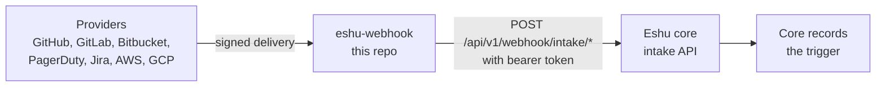

# eshu-webhook

Status: pre-release. This service does not yet replace the webhook
handling in Eshu core.

One-line identity: a small HTTP service that checks signed webhook
deliveries, turns the ones it knows into a common form, and passes them
to Eshu core.

## What it is

Git hosts and other tools send webhooks — HTTP callbacks that say
"something changed." Eshu uses those callbacks as hints to refresh what
it knows. This service sits at the edge. It proves a delivery really
came from the named provider, rewrites it into Eshu core's intake form,
and submits it. It stores nothing.

Words used in this file:

- Delivery: one webhook HTTP request from a provider.
- Intake: Eshu core's HTTP API that receives checked deliveries.
- Trigger: the record core makes after it accepts a delivery. This
  service sends triggers to core. It does not make facts (Eshu's stored
  observations) itself.

## Why it exists

Signature checks and provider quirks should live in one small place.
Core should receive one trusted, common shape. Keeping this service
separate also means it can be run and released on its own.



Text version: a provider sends a signed delivery to eshu-webhook.
eshu-webhook checks and rewrites it, then posts it to Eshu core's
intake API. Core records the trigger. There is no arrow from webhooks
to facts in this repo.

## When to use it

Use it when a deployment needs provider webhooks checked and rewritten
before they reach core's intake API.

Do not use it when:

- You need stored webhook history. This service stores nothing.
- You need facts read back. Core owns stored triggers and later steps.
- Core's intake API is not available. Without it, this service refuses
  to start, because it would have nowhere to hand deliveries.

## How to run it

Set at least one provider secret or freshness token, plus the intake
URL and token together. Then run:

```bash
go run ./cmd/webhook
```

The binary reads environment variables only (see Configuration). It
listens on `:8080` by default. Checks:

```bash
curl http://127.0.0.1:8080/healthz   # this process is up
curl http://127.0.0.1:8080/readyz    # core /healthz also answers
curl http://127.0.0.1:8080/metrics   # request counts and timing
```

`/readyz` reports not-ready when core cannot be reached. That is on
purpose: a copy that cannot hand work to core should not get traffic.

## How it works

Data in: one `POST` per delivery, on a provider path, with the
provider's signature or token header. Bodies over the size cap are
rejected. The cap defaults to 1 MiB (1048576 bytes).

What happens, in order:

1. Read the body within the cap. Only `POST` is allowed.
2. Check the signature or token for that provider. A bad check gets
   `401` and stops there.
3. Rewrite known events into the intake form. Unknown events get
   `422`. A verified delivery that cannot be rewritten also gets
   `422`.
4. Post the form to core with a bearer token (a shared secret in the
   `Authorization` header). Core's answer decides the final status:
   accepted work gets `202`, a conflicting delivery gets `409`, and a
   failed hand-off gets `502`.

Data out: intake posts to core, one JSON log line per provider request
on stderr, and metrics on `GET /metrics`. Log lines never carry the
body, a secret, a token, or a signature.

### Verified triggers only

This service passes triggers to core. It never writes facts.
Only the events the code maps are accepted. Known mappings in this
tree:

- GitHub: `push`; `pull_request` mapped to `pull_request_merged`
  (an unmerged close carries an `ignored` decision); `workflow_run` and
  `workflow_job` go to the actions intake. A signed `ping` answers
  `202` locally with reason `ping` and makes no intake call.
- GitLab: `push` and merged merge requests.
- Bitbucket: `repo:push` and `pullrequest:fulfilled`.
- PagerDuty and Jira: incident-style events, sent to the incident
  intake. Each needs its configured scope id (see Configuration).
- AWS: EventBridge freshness deliveries, checked with a bearer token.
- GCP: Pub/Sub push messages for Cloud Asset Inventory changes,
  checked with a bearer token. The first-subscription welcome message
  is answered locally (`202`, reason `welcome_message`) and is not sent
  to core.

Intake routes used, per `intake.go`: `/api/v1/webhook/intake/repository`,
`/api/v1/webhook/intake/actions`, `/api/v1/webhook/intake/incident`,
`/api/v1/webhook/intake/aws`, and `/api/v1/webhook/intake/gcp`.
Every submission carries intake API version `v1`.

### Supported core versions

Supported core range, from the prior README's wire check: Eshu `main`
from `50ba1f2a70` (2026-10-30, first build with the `webhook-intake`
host) through `d2eca4fb01` (2026-11-01, newest build checked). No tagged
core release carried the host at that check; core tags ended at
`v0.0.3-pre-release-18`. Changing the wire version means changing this
range in the same change. `compatibility_test.go` pins the `v1` string.

## Configuration

All settings come from the environment. Names below are read in
`config.go`. At least one provider secret or freshness token is
required. The intake URL and token must be set together.

| Variable | Default | Meaning |
|---|---|---|
| `ESHU_WEBHOOK_GITHUB_SECRET` | — | Secret for GitHub `X-Hub-Signature-256` (HMAC SHA-256) |
| `ESHU_WEBHOOK_GITLAB_TOKEN` | — | Token compared with GitLab `X-Gitlab-Token` |
| `ESHU_WEBHOOK_BITBUCKET_SECRET` | — | Secret for Bitbucket `X-Hub-Signature` (HMAC SHA-256) |
| `ESHU_WEBHOOK_PAGERDUTY_SECRET` | — | Secret for PagerDuty `X-PagerDuty-Signature` (`v1=` HMAC SHA-256) |
| `ESHU_WEBHOOK_JIRA_SECRET` | — | Secret for Jira `X-Hub-Signature` (HMAC SHA-256) |
| `ESHU_AWS_FRESHNESS_TOKEN` | — | Bearer token for AWS EventBridge deliveries |
| `ESHU_GCP_FRESHNESS_TOKEN` | — | Bearer token for GCP Pub/Sub pushes |
| `ESHU_WEBHOOK_INTAKE_URL` | — | Core intake base URL (scheme and host only) |
| `ESHU_WEBHOOK_INTAKE_TOKEN` | — | Bearer token sent to core |
| `ESHU_WEBHOOK_LISTEN_ADDR` | `:8080` | Listen address |
| `ESHU_WEBHOOK_MAX_BODY_BYTES` | `1048576` | Largest accepted delivery body |
| `ESHU_WEBHOOK_GITHUB_PATH` | `/webhooks/github` | GitHub route |
| `ESHU_WEBHOOK_GITLAB_PATH` | `/webhooks/gitlab` | GitLab route |
| `ESHU_WEBHOOK_BITBUCKET_PATH` | `/webhooks/bitbucket` | Bitbucket route |
| `ESHU_WEBHOOK_PAGERDUTY_PATH` | `/webhooks/pagerduty` | PagerDuty route |
| `ESHU_WEBHOOK_JIRA_PATH` | `/webhooks/jira` | Jira route |
| `ESHU_AWS_FRESHNESS_PATH` | `/webhooks/aws/eventbridge` | AWS route |
| `ESHU_GCP_FRESHNESS_PATH` | `/webhook/gcp-freshness` | GCP route |
| `ESHU_WEBHOOK_PAGERDUTY_SCOPE_ID` | — | Scope stamped on PagerDuty events |
| `ESHU_WEBHOOK_JIRA_SCOPE_ID` | — | Scope stamped on Jira events |
| `ESHU_WEBHOOK_DEFAULT_BRANCH` | — | Fallback branch name when a payload omits it |

HMAC means a keyed hash: a short code computed from the body and a
shared secret. Matching codes prove the sender knew the secret.
GitLab, AWS, and GCP checks compare shared tokens instead. All
comparisons use a timing-safe compare in `signature.go`. GitHub's
legacy SHA-1 signature header is not accepted.

## Deploy

Build the image:

```bash
docker build -t eshu-webhook .
```

The image is one static binary (`/usr/local/bin/webhook`) on a
distroless base, running as user `65532`. It needs no volumes and runs
no migrations. Give it the environment above. Only expose the provider
webhook paths through a public entry point; scrape `/metrics` inside
the cluster, because it shares the same listener.

## Eshu dependencies

- Needs: Eshu core's intake API at `ESHU_WEBHOOK_INTAKE_URL`, and the
  matching bearer token. It also needs the provider secrets for the
  providers you enable.
- Talks to: core (`POST /api/v1/webhook/intake/*`, plus `GET /healthz`
  for readiness) and the providers that call it.
- Never touches: any database, graph, queue, or volume. The code keeps
  no storage; durable trigger records stay in core.

## Operations

- Health: `GET /healthz` is local only. `GET /readyz` also probes
  core's `/healthz`.
- Metrics: `eshu_webhook_requests_total` (counter, labels `provider`,
  `outcome`, `reason`) and `eshu_webhook_request_duration_seconds`
  (histogram, label `provider`), served as Prometheus text `0.0.4`.
  Health and metrics paths are not counted.
- Logs: one JSON record per provider request on stderr with `route`,
  `provider`, `method`, `status`, `outcome`, `reason`, `delivery_id`,
  and `duration_ms`. Useful reasons include `accepted`, `ping`,
  `bad_signature`, `bad_token`, `oversized_body`,
  `unsupported_event`, `invalid_payload`, `delivery_conflict`, and
  `intake_failed`. Note: GitHub does not retry a failed delivery on its
  own; a `502` must be redelivered by hand from GitHub's delivery log.
- Common 3 AM answer: if providers report failures, first check
  `/readyz`. If it fails, core or the network path to core is the
  problem, not the signatures.

## Development

Go version is pinned in `go.mod` (`go 1.26.10`, module
`github.com/eshu-hq/eshu-webhook`, standard library only).

```bash
make ci     # lint + test + race, with the coverage floor
make lint   # vet, golangci-lint, format check, tidy, 500-line cap
make test   # build + full test suite
make race   # race suite + coverage floor (90.0)
```

`make ci` needs `go`, `golangci-lint` v2.12.2, and `git`. CI adds
shell, image, boundary, govulncheck, gosec, and actionlint lanes.
GCP retry and normalization cases are pinned by recorded fixtures
under `testdata/gcp/`; see the tests beside `gcp_normalize.go`.

## Docs and related

- [CONTRIBUTING.md](CONTRIBUTING.md) — local checks and CI lanes.
- [SECURITY.md](SECURITY.md) — how to report a problem.
- `doc.go` — package summary. `config.go` — every environment name.

## Contributing, security, license

See [CONTRIBUTING.md](CONTRIBUTING.md) before opening a pull request.
Report security problems as described in [SECURITY.md](SECURITY.md);
do not open a public issue for them. Source files carry
`SPDX-License-Identifier: MIT`; there is no separate LICENSE file in
this tree.
