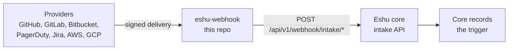

# eshu-webhook

Status: pre-release. It doesn't replace the webhook handling in Eshu
core yet.

Here's the short version: providers like GitHub send webhooks when
something changes. This small HTTP service checks that a delivery
really came from the provider it claims, rewrites it into the shape
Eshu core expects, and hands it over. It stores nothing, and it never
writes facts. Core records a trigger from what it accepts, and
whatever happens after that is core's business.



In words: a provider sends a signed delivery here, we check and
rewrite it, then post it to core's intake API. There's deliberately
no arrow from webhooks to facts. This service only passes triggers.

## When you'd use it, and when you wouldn't

Reach for it when a deployment wants provider webhooks verified and
normalized before they touch core's intake API. Signature checks and
provider quirks live in one small place, and core only ever sees one
trusted shape.

Skip it if you need stored webhook history (we keep none), if you
want facts read back (core owns that), or if core's intake API isn't
available. Without an intake URL and token it refuses to start,
because it'd have nowhere to hand deliveries.

## Getting it running

Set at least one provider secret or freshness token, plus the intake
URL and token together (full list in the configuration doc), then:

```bash
go run ./cmd/webhook
curl http://127.0.0.1:8080/healthz   # this process is up
curl http://127.0.0.1:8080/readyz    # core answers too
```

It listens on `:8080` by default and reads environment variables
only. `/readyz` also probes core, so a copy that can't reach core
won't take traffic. That's on purpose.

## Documentation

| Doc | What's in it |
|---|---|
| [docs/README.md](docs/README.md) | Documentation index: start here |
| [docs/getting-started/README.md](docs/getting-started/README.md) | Run it locally and see health answer |
| [docs/guides/](docs/guides/README.md) | Operate, troubleshoot, provider setup, and release |
| [docs/concepts/](docs/concepts/README.md) | The delivery contract and boundaries |
| [docs/reference/configuration.md](docs/reference/configuration.md) | Every environment variable, the signature checks, and secret handling |
| [docs/architecture/README.md](docs/architecture/README.md) | Where this service sits in Eshu |
| [docs/diagrams/README.md](docs/diagrams/README.md) | Every diagram, with captions and text versions |
| [docs/decisions/README.md](docs/decisions/README.md) | Architecture decision records |
| [docs/contributing/README.md](docs/contributing/README.md) | Local checks before a pull request |
| [CONTRIBUTING.md](CONTRIBUTING.md) | Local checks and CI lanes |
| [SECURITY.md](SECURITY.md) | How to report a problem |

A few terms, since the docs use them a lot: a delivery is one webhook
HTTP request, intake is core's API that receives checked deliveries,
and a trigger is the record core makes after accepting one.

## Related repos

- [eshu](https://github.com/eshu-hq/eshu): core. It owns the intake
  API, the stored triggers, and everything downstream of them.
- [eshu-collector-aws-cloud](https://github.com/eshu-hq/eshu-collector-aws-cloud)
  and the other collectors: they do the actual reading once core
  decides a refresh is due. Nothing here calls them directly.

## Development

Go `1.26.10` (pinned in `go.mod`, standard library only). Run
`make ci` for lint, tests, and the race suite with its coverage
floor. Details sit in [contributing](docs/contributing/README.md).

## Contributing, security, license

See [CONTRIBUTING.md](CONTRIBUTING.md) before opening a pull request.
Report security problems as described in [SECURITY.md](SECURITY.md),
not as a public issue. Source files carry
`SPDX-License-Identifier: MIT`. There's no separate LICENSE file in
this tree.
