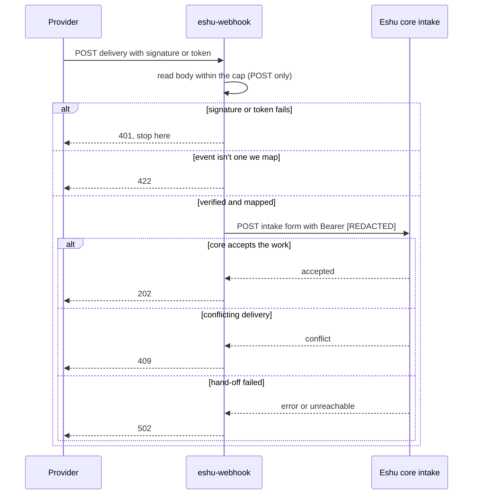

# Diagrams

Every diagram for `eshu-webhook` lives here, each with a
caption and a text version you can read without rendering.
Other pages link here instead of copying diagrams. The
[top-level README](../../README.md) keeps the first overview
only.

## Overview: providers to core

Caption: a provider sends a signed delivery to eshu-webhook;
we verify and rewrite it, then post it to core's intake API.
Core records the trigger. There is no arrow from webhooks to
facts, and that's a design rule.

```mermaid
flowchart LR
  P[Providers<br/>GitHub, GitLab, Bitbucket,<br/>PagerDuty, Jira, AWS, GCP] -->|signed delivery| W[eshu-webhook<br/>this repo]
  W -->|POST /api/v1/webhook/intake/*<br/>with a Bearer [REDACTED]| C[Eshu core<br/>intake API]
  C --> T[Core records<br/>the trigger]
```

Text version: Providers → (signed delivery) → eshu-webhook →
(POST /api/v1/webhook/intake/* with a Bearer [REDACTED]) → Eshu
core intake API → core records the trigger.

## One delivery, start to finish

Caption: one POST is read within the size cap, its signature
or token checked, known events rewritten, and core's answer
mapped to the final status for the provider.



Text version: the provider posts a delivery. We read the
body within the cap, check the signature or token (a bad
check gets `401` and stops), then rewrite known events into
the intake form. Unknown events get `422`, and so does a
verified delivery we can't rewrite. We post the form to core
with a Bearer [REDACTED] and core's answer decides the final
status: `202` accepted, `409` conflicting delivery, `502`
hand-off failed.
